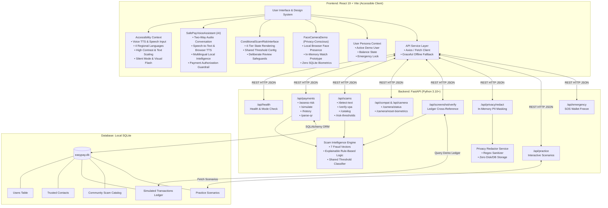

# 🛡️ EasyPay & SafePay — CyberCare Intelligence

> **Accessible Digital Payment Assistance, Scam Prevention & Senior Cyber Protection**  
> Specially designed for older adults, deaf individuals, non-speaking users, and digital beginners who find digital payments stressful or confusing.

---

## ⚠️ Important Simulation Notice & Disclaimer

> **Demo application. No real money is transferred.**  
> EasyPay & SafePay is designed exclusively for educational, accessibility training, and cyber fraud prevention purposes:  
> - **No real money** is ever debited, credited, or moved.
> - **Never enter or store** real bank account passwords, UPI PINs, SMS OTPs, or debit card credentials.
> - All account balances, transaction records, and payment confirmations are synthetic simulations stored in a local SQLite database to empower users to practice digital payments safely without financial risk.

---

## 🌟 Executive Summary & Problem Statement

Digital payments in India through UPI and mobile wallets have revolutionized commerce, but have simultaneously created an epidemic of cyber fraud targeting vulnerable demographics:
1. **Older Adults & Digital Beginners**: Often intimidated by complex interfaces and susceptible to psychological pressure tactics (fake 15-minute electricity disconnection threats, fake police "digital arrest" video calls, and reverse PIN traps).
2. **Deaf & Hard of Hearing Individuals**: Traditional fraud warnings and banking customer support rely almost exclusively on phone calls, IVR voice systems, and audio soundbox chimes.
3. **Non-Speaking Users**: Lack simple, non-verbal ways to review, verify, and complete routine payments without social anxiety or rushed decisions.

**EasyPay & SafePay** solves this through **CyberCare Intelligence**—a multi-layered accessibility and scam-prevention system featuring:
- A guided 3-step payment simulator with real-time scam interception.
- A transparent, rule-based, explainable scam detector with zero paid external AI dependencies.
- A local SQLite ledger cross-referencing Screenshot Checker.
- An in-memory Privacy Redactor that sanitizes sensitive PII with a zero-data-storage guarantee.
- Regional-language voice guidance (English, Kannada, Hindi, Telugu) with an instant Silent Mode and visual flash alerts.
- A comprehensive Senior Safety Centre featuring the 5 Golden Rules, an emergency fraud response checklist, verified Indian cybercrime reporting helplines, and an interactive 6-scenario scam defense quiz.

---

## 🏗️ System Architecture

The project is built on a clean decoupled architecture combining a high-performance **FastAPI (Python 3.10+)** backend, a **React 19 + Vite** frontend, and a local **SQLite** ledger.



---

## 📊 Implemented Features vs. System Limitations

To maintain absolute academic and hackathon integrity, the table below clearly distinguishes all **fully implemented & tested features** from **deliberate educational boundaries / out-of-scope items**:

| Feature Area | ✅ Fully Implemented & Tested | ⚠️ Deliberate Limitations / Out of Scope |
| :--- | :--- | :--- |
| **EasySafePay Uizard UI Design** | • Sleek dark obsidian palette (`#0a0e17`, `#111726`, `#182033`) with electric rose & neon purple gradient accents (`#f43f5e`, `#ec4899`, `#8b5cf6`).<br/>• **Dashboard Overview**: Total balance card (`₹15,000.00` demo balance), quick actions ("Send Money", "Scam Shield", "Scan QR", "Reset Demo"), and Quick Pay Verified Contacts carousel.<br/>• **Payments — Send / Request**: Segmented tab control with interactive Request Money simulator and crucial UPI Collect scam education.<br/>• **Security Notifications**: Live floating notification drawer with 4 real-time cyber security advisories (Power-cut SMS alert, ML shield status, verified payee, 1930 helpline).<br/>• Preserves all high-contrast AAA accessibility modes for seniors and low-vision users. | **Simulation Boundary**: Visual fintech prototype with simulated balances and synthetic transaction records. Never moves real money. |
| **Real Scikit-Learn ML Scam Detector** | • Local ML model trained using `scikit-learn` `TfidfVectorizer` (sublinear TF, unigram+bigram, 1500 features) + `LogisticRegression` (L2 regularization, `liblinear` solver).<br/>• Trained on 80 labeled Indian payment messages (40 legitimate, 40 scam) and evaluated on a held-out test set (Accuracy: 1.00, F1: 1.00).<br/>• Saved artifact: `backend/app/ml/scam_model.joblib` loaded automatically on FastAPI startup.<br/>• Displays model prediction (`LEGITIMATE` / `SCAM`), confidence score (0–100%), scam probability, detected indicators, and recommended action.<br/>• **Mandatory Rule Overrides**: Suspicious requests for OTPs, UPI PINs, passwords, or remote desktop screen-sharing tools (AnyDesk, TeamViewer) override ML predictions directly to `CRITICAL` or `HIGH` risk. | **Synthetic Data Disclosure**: Trained on synthetic educational examples for digital fraud awareness. Does not claim to represent real-world national fraud statistics or guarantee absolute detection. |
| **FEATURE 1: Conditional Scam-Risk Interface** | • Dynamic 4-tier conditional rendering (`LOW`, `MEDIUM`, `HIGH`, `CRITICAL`) connected to live backend assessment.<br/>• Shared threshold configuration (`GET /api/scams/risk-thresholds` & frontend config: CRITICAL &ge; 80, HIGH &ge; 50, MEDIUM &ge; 25, LOW &ge; 0).<br/>• **Low Risk**: Calm message ("No major warning signs detected"), recipient verification reminder, no false guarantee of absolute safety.<br/>• **Medium Risk**: Visible caution, plain-language warning signs, recipient/amount/purpose review prompts, Review Again and Cancel actions.<br/>• **High Risk**: "Stop and check before proceeding" alert, exact suspicious indicators, dangerous rationale, Cancel and Get Safety Advice options, explicit acknowledgement required before continuing demo.<br/>• **Critical Risk**: Prominent stop warning, strongest indicators, official contact verification advice, **no one-click bypass**, multi-step structured safety review flow.<br/>• Non-color-only design: high-contrast icons, text badges, ARIA alerts, keyboard navigation, duplicate submission prevention. | **Simulation Boundary**: Risk ratings are computed by the deterministic local engine. Does not guarantee absolute absence of fraud. Payments remain purely simulated. |
| **FEATURE 2: Two-Way AI Voice Assistant ("Speak to SafePay")** | • Dedicated conversational AI assistant with prominent launcher in top Navbar, persistent bottom-right floating badge, and full embed on Voice page.<br/>• **Speech Recognition**: Browser Web Speech API (`SpeechRecognition` / `webkitSpeechRecognition`) converting speech to text.<br/>• **Text Preview**: Recognized speech is explicitly displayed before taking action, with edit capability.<br/>• **Multilingual Brain**: Local zero-cloud intent understanding in **English (`en`)**, **Kannada (`kn`)**, **Hindi (`hi`)**, and **Telugu (`te`)**.<br/>• **Browser TTS**: Reads responses aloud with **Stop Speaking** and **Repeat** buttons.<br/>• **Typing Fallback**: Full keyboard input on every screen.<br/>• **CRITICAL GUARDRAIL**: Voice commands NEVER authorize payments, bypass scam warnings, or confirm transactions. Navigation and explanations only.<br/>• **Zero Audio Retention**: No audio is recorded, stored, uploaded, or transmitted to any third party. | **Browser Support**: Web Speech API is natively supported in Chrome, Edge, and Chromium browsers. On Firefox/Safari or when mic permission is denied, the graceful keyboard typing alternative handles all queries seamlessly. |
| **FEATURE 3: Camera & Face Features (Privacy-Conscious)** | • Dedicated "Face & Camera Demo" page (`/camera-demo`).<br/>• **Explicit Consent**: Hardware camera permission requested *only* after pressing "Start Camera".<br/>• **Active Indicator & Teardown**: Prominent pulsing camera-on badge; immediate hardware stream track release (`track.stop()`) on "Stop Camera" or page exit.<br/>• **Local Face Presence Detection**: Local browser canvas analysis and W3C Shape Detection API (`FaceDetector`). Clearly labeled: **"Face detected (Identity Unknown)"**.<br/>• **In-Memory Matching Prototype**: Optional consent-based reference registration kept strictly in transient browser session memory. Clearly separates detection from matching.<br/>• **Zero SQLite Biometrics**: Verified via backend test `test_camera_status_and_privacy_safeguards`. No face images, vectors, or biometric templates are stored in SQLite or on disk.<br/>• **Reset & Manual Alternative**: Instant "Delete / Reset Biometrics" action and a complete manual PIN alternative for users who cannot or do not wish to use a camera. | **Prototype Boundary**: Demonstrates local on-device biometric security principles without requiring heavy neural dependencies (e.g. OpenCV/dlib) in the minimal hackathon environment. Face recognition is strictly prohibited from authorizing payments alone. |
| **Guided Payment Simulator** | Complete 3-step workflow (`FORM` &rarr; `CONFIRMATION` &rarr; `RESULT`), recipient name & UPI format validation, amount validation (rejection of ₹0, negative, and excessive amounts), real-time safety review, high-risk payment pausing, demo ID generation (`DEMO-TXN-YYYYMMDD-####`), SQLite ledger persistence. | **Simulated Only**: Never connects to real banking networks, NPCI UPI switch, or live payment gateways. No actual money is debited or credited. |
| **SafePay Scam Detector** | 7-vector explainable rule-based engine combined with Scikit-learn ML covering OTP/PIN theft, power disconnection threats, advance-fee lottery prizes, suspicious links, remote access screen-share tools, authority impersonation, and reverse PIN traps. Generates risk scores (0–100), risk tiers (`LOW`, `MEDIUM`, `HIGH`, `CRITICAL`), plain-language warnings, and actionable next steps. | **Zero Cloud LLM**: Does not call OpenAI, Anthropic, or paid cloud APIs. Uses transparent, fast, deterministic local heuristics that never hallucinate and run 100% privately. |
| **Screenshot Checker** | Validates PNG, JPG, and JPEG files up to 5 MB. Cross-references manual transaction reference codes and amounts against synthetic records in the local SQLite demo ledger. Returns `VERIFIED IN DEMO LEDGER`, `NOT FOUND IN DEMO LEDGER`, or `UNABLE TO VERIFY`. Warns users that screenshots alone cannot prove payment. | **Assisted Verification**: Does not execute server-side neural OCR on raw images; cross-references manually entered or preset references against the local SQLite ledger. Never connects to live bank servers. |
| **Privacy Redactor** | In-memory regex masking of OTPs, Indian phone numbers, emails, 16-digit cards, 12-digit Aadhaar, 10-char PAN, and UPI handles. One-click clipboard copying with fallback, category counters, and explicit zero-data-storage guarantee. | **Heuristic Masking**: Does not use machine learning named entity recognition (NER). Clearly warns users that unusual handwriting or non-standard formatting requires human inspection. |
| **Voice & Accessibility** | Full multi-language translation and speech synthesis across **English (`en`)**, **Kannada (`kn`)**, **Hindi (`hi`)**, and **Telugu (`te`)**. Silent Mode (mutes audio & animations), high contrast modes (Yellow on Black, Dark, Clean), text scaling (Standard, Large, Extra Large), keyboard navigation with visible focus rings. | **Safety Guardrail**: Voice recognition is strictly prohibited from authorizing payments. Voice input is strictly an optional typing aid; confirmations require deliberate physical clicks. |
| **Safety Centre & Quiz** | 5 Golden Rules of digital payment safety, explanations and examples of 6 common scam patterns, 6-step fraud checklist, verified official Indian helplines (1930, 14567, 14431, 112, Sachet), bank emergency desks, and a 6-scenario scam defense quiz with score tracking and restart. | **Honest Reality**: Clearly states that lost money recovery is never guaranteed. Does not automate live filing to police portals (which legally require citizen Aadhaar/OTP verification). |

---

## 💻 Exact Windows Installation & Startup Commands

Follow these exact commands in **Windows PowerShell** to install and run the application from scratch:

### Prerequisites
- **Python 3.10+** (Python 3.11, 3.12, 3.13, or 3.14 verified)
- **Node.js 18+** & **npm**
- **Windows PowerShell**

### Step 1: Clone & Navigate
```powershell
cd c:\Users\w2c\OneDrive\Desktop\spark_reva
```

### Step 2: Set Up Backend Virtual Environment
```powershell
# Create Python virtual environment if not already present
python -m venv backend\venv

# Upgrade pip and install dependencies
backend\venv\Scripts\python.exe -m pip install --upgrade pip
backend\venv\Scripts\pip install -r requirements.txt
```

### Step 3: Initialize Local SQLite Database
```powershell
backend\venv\Scripts\python.exe -m backend.app.init_db
```
*(This seeds default senior personas, verified neighborhood contacts, common scam catalogs, and demo transactions into `backend/easypay.db`.)*

### Step 4: Install Frontend Dependencies
```powershell
npm.cmd --prefix frontend install
```

### Step 5: Start the Backend Server (Terminal 1)
```powershell
backend\venv\Scripts\python.exe -m uvicorn backend.app.main:app --reload --port 8000
```
- **Backend Health Check**: [http://localhost:8000/api/health](http://localhost:8000/api/health)
- **Interactive OpenAPI/Swagger Docs**: [http://localhost:8000/docs](http://localhost:8000/docs)

### Step 6: Start the Frontend Client (Terminal 2)
Open a second PowerShell window:
```powershell
npm.cmd --prefix frontend run dev
```
Open your browser to:
- **Application URL**: [http://localhost:5173](http://localhost:5173)

### Step 7: Unified Production Server & Cloud Deployment (Single Port)
You can also run both the compiled React frontend and FastAPI backend together on a single port with zero proxy dependencies:
```powershell
python run_production.py
# Or using npm
npm start
```
- **Unified Production URL**: [http://localhost:8000](http://localhost:8000)
- **Interactive Swagger Docs**: [http://localhost:8000/docs](http://localhost:8000/docs)
- **Cloud Deployment Guide**: For 1-click cloud deployment on **Render**, **Railway**, or **Hugging Face Spaces**, see [DEPLOYMENT.md](./DEPLOYMENT.md).

---

## 🧪 Testing Commands

The project includes an automated test suite with **64 backend unit tests** (100% passing) and clean frontend build verification:

### 1. Run Complete Backend Test Suite
```powershell
backend\venv\Scripts\python.exe -m pytest -v backend/tests
```
**Output**: `64 passed in <3.0s` across:
- `test_ml_scam_detector.py` (**6 tests**: local model loading, scam vs legitimate message classification, rule overrides for OTPs and remote APKs, 4-tier score clamping, risk assessment metadata)
- `test_conditional_risk_and_features.py` (**9 tests**: shared risk-threshold config endpoint, 4-tier classification, LOW/MEDIUM/HIGH/CRITICAL scam detector states, payment risk interception and acknowledgement override, camera status and zero SQLite biometric safeguards)
- `test_scam_protection_payment_flow.py` (7 tests: safe payments, scam warnings, pause on risk, cancellation, disclaimers, amount limits)
- `test_screenshot_and_privacy_redactor.py` (8 tests: verified in demo ledger, not found unknown reference, altered amount mismatch, unable to verify, fake screenshot disclaimer, privacy redaction categories, zero-storage verification)
- `test_safety_centre.py` (6 tests: practice scenarios, correct rejections, incorrect approvals, keyword alignment)
- `test_scam_detector.py` (10 tests: OTP theft, power cuts, lottery prizes, remote apps, links, QR codes, empty/long inputs)
- `test_payments.py` (6 tests: successful simulated payments, insufficient balance, scam interception, emergency freeze, zero/negative rejection, demo transaction ID generation)
- `test_scam_engine.py` (3 tests: trusted contacts, blacklisted handles, reverse PIN traps)
- `test_compat_endpoints.py` (7 tests: recipients, risk assessment, payment simulation, transaction history, accessibility preferences, screenshot verification)
- `test_health.py` (2 tests: GET /api/health and root simulation disclaimer)

### 2. Run Specific Subsystem Tests
```powershell
# Test Feature 1 (Conditional Risk Tiers) & Feature 3 (Camera Privacy Safeguards)
backend\venv\Scripts\python.exe -m pytest -v backend/tests/test_conditional_risk_and_features.py

# Test Guided Payment Flow & Scam Protection
backend\venv\Scripts\python.exe -m pytest -v backend/tests/test_scam_protection_payment_flow.py

# Test Screenshot Checker & Privacy Redactor
backend\venv\Scripts\python.exe -m pytest -v backend/tests/test_screenshot_and_privacy_redactor.py

# Test Safety Centre & Scam Scenarios
backend\venv\Scripts\python.exe -m pytest -v backend/tests/test_safety_centre.py
```

### 3. Build Frontend for Production
```powershell
npm.cmd --prefix frontend run build
```
**Output**: `✓ built in ~450ms` (Clean compilation via Vite with zero bundle errors).

### 4. Run Frontend Linter
```powershell
npm.cmd --prefix frontend run lint
```

---

## 🔧 Troubleshooting Instructions

| Issue | Root Cause | Exact Solution |
| :--- | :--- | :--- |
| **Port 8000 already in use** (`[Errno 10048] error while attempting to bind on address ('127.0.0.1', 8000)`) | A previous FastAPI or Uvicorn instance is still holding port 8000. | In PowerShell run:<br/>`Get-Process -Id (Get-NetTCPConnection -LocalPort 8000).OwningProcess \| Stop-Process -Force` |
| **Port 5173 already in use** (Vite falls back to 5174) | Another Node process is running Vite. | In PowerShell run:<br/>`Get-Process -Id (Get-NetTCPConnection -LocalPort 5173).OwningProcess \| Stop-Process -Force` |
| **PowerShell script execution disabled** (`PSSecurityException`) | Windows default execution policy prevents running unverified scripts. | In your PowerShell terminal run:<br/>`Set-ExecutionPolicy -Scope Process -ExecutionPolicy Bypass` |
| **Text-to-Speech not speaking audio** | Modern browsers (Chrome, Edge) require a user gesture (click) before granting audio autoplay. | Click anywhere on the web page or tap the **"🔊 Read instructions aloud"** button directly to initialize the browser's speech synthesis engine. Ensure browser tab is unmuted. |
| **Speech Recognition not working** | The Web Speech API SpeechRecognition interface is supported natively in Chrome, Edge, and Chromium-based browsers, but requires microphone permission. | Tap "Allow" when the browser requests microphone access. If running offline or in unsupported browsers, use the full keyboard typing alternative provided on every screen. |
| **CORS errors or backend disconnected notice** | Frontend is attempting to connect to `http://localhost:8000` while backend is stopped. | Verify backend is active on port 8000. The frontend automatically falls back to local in-browser heuristics and simulated mock data so the app remains interactive even if the backend is temporarily offline. |

---

## ⏱️ Three-Minute Hackathon Demonstration Script

### Timing Breakdown
- **0:00 – 1:00 (Minute 1)**: Problem Statement & Guided Payment Simulation with Feature 1: Conditional Scam-Risk Interface (4 Tiers: LOW, MEDIUM, HIGH, CRITICAL).
- **1:00 – 2:00 (Minute 2)**: Feature 2: Two-Way AI Voice Assistant ("Speak to SafePay") in English, Kannada, Hindi, Telugu with Guardrails.
- **2:00 – 3:00 (Minute 3)**: Feature 3: Privacy-Conscious Face & Camera Demo (Zero SQLite biometrics, manual alternative), Screenshot Checker & Safety Centre.

---

### Detailed Demonstration Flow

#### Minute 1: Feature 1 — Conditional Scam-Risk Interface & Payment Flow
1. **Show the Dashboard**:
   - Open [http://localhost:5173](http://localhost:5173).
   - Point out the top simulation banner: *"Demo application. No real money is transferred."*
   - Highlight the live FastAPI backend health indicator card.
2. **Demonstrate All 4 Conditional Risk Tiers in SafePay Scam Checker**:
   - Click **"SafePay Scam Checker"** in the navigation bar.
   - **LOW RISK DEMO**: Paste `Hi Mom, I bought groceries for Rs 120, let's have dinner tonight`. Click **"Check for Scam"** &rarr; Shows green calm card: *"No major warning signs were detected"*, reminder to independently verify recipient, and prominent note that **no message is ever guaranteed 100% safe**.
   - **MEDIUM RISK DEMO**: Paste `Hurry! You won Rs 500 gift voucher. Please verify your address at payment-gift.xyz`. Click **"Check for Scam"** &rarr; Shows amber caution card with simple language explanations, asking user to review recipient/amount, offering **Review Again** and **Cancel** buttons.
   - **HIGH RISK DEMO**: Paste `URGENT: Your SBI bank account will be BLOCKED today. Share your 6-digit OTP immediately or call 9876543210`. Click **"Check for Scam"** &rarr; Shows prominent orange banner: *"Stop and check before proceeding"*, listing exact suspicious indicators (OTP Theft, Authority Impersonation, Urgent Threats), offering **Cancel Payment** and **Get Safety Advice**, requiring explicit warning acknowledgement.
   - **CRITICAL RISK DEMO**: Paste `ELECTRICITY DISCONNECTION ALERT: Power will be cut at 9:30 PM. Call officer now. Scan QR to send Rs 100 to receive refund or install AnyDesk`. Click **"Check for Scam"** &rarr; Shows red critical stop screen: **no one-click bypass**, explains strongest detected warning signs, recommends calling official utility helpline, pauses payment until deliberate multi-step review checklist is completed.
3. **Show Scam Interception in Guided Payment**:
   - Click **"Make Payment"** &rarr; select preset **"⚡ Electricity Threat (₹1,450)"** &rarr; click **"Review Demo Payment"** &rarr; Notice instant risk interception pausing the payment with the deliberate safety review before any simulated money moves.

#### Minute 2: Feature 2 — Two-Way AI Voice Assistant ("Speak to SafePay")
1. **Show How to Launch the AI Assistant**:
   - Highlight the top navigation button: **"🎙️ Speak to SafePay"**.
   - Point out the persistent bottom-right floating badge: **"🎙️ Speak to SafePay (AI)"**.
   - Navigate to the **"Voice & Language"** page &rarr; notice the complete two-way conversational AI assistant embedded directly at the top.
2. **Two-Way Voice Interaction**:
   - Tap **"🎙️ Speak to SafePay"** &rarr; Browser requests microphone permission with friendly visual status.
   - Speak: *"Can someone ask my UPI PIN to give me refund?"*
   - **Text Preview**: SafePay displays the recognized text on screen: *"Recognized: Can someone ask my UPI PIN to give me refund?"* before taking action.
   - **Spoken AI Response**: SafePay reads aloud the Golden Rule: *"You only enter your UPI PIN to SEND money, never to receive a refund or lottery prize. Legitimate banks and officials NEVER ask for your OTP or UPI PIN."*
   - Show the **"Stop Speaking"** and **"Repeat"** audio control buttons.
3. **Test Regional Languages**:
   - Switch voice language to **"ಕನ್ನಡ (Kannada)"** and ask *"Hana kalsi"* &rarr; Assistant speaks in Kannada explaining the safety rule.
   - Switch to **"हिन्दी (Hindi)"** and ask *"Kya OTP bataye?"* &rarr; Assistant responds in Hindi warning against OTP theft.
4. **Demonstrate Strict Safety Guardrails**:
   - Speak or type: *"Confirm payment of 500 rupees"* or *"Authorize payment"*.
   - *Assistant Response*: *"Strict Safety Rule: Voice recognition will NEVER authorize a payment or bypass scam warnings. Opening Make Payment now so you can visually inspect recipient details and manually confirm."*
   - Explains that voice is an accessibility aid, never proof of consent.

#### Minute 3: Feature 3 — Camera & Face Features, Screenshot Checker & Safety Centre
1. **Navigate to "Face & Camera Demo"**:
   - Click **"Face & Camera Demo"** in the navigation bar.
   - Point out the privacy safeguards: Camera is **OFF** by default.
   - Click **"📷 Start Camera"** &rarr; Browser requests camera permission.
   - Note the prominent visual green pulsing badge: **"● Camera Active (Live Stream)"**.
   - Look at the detection banner: local browser canvas/Shape Detection detects face presence and displays: **"Face detected (Identity Unknown)"**. Explicitly highlights that identity is unknown and unverified.
2. **In-Memory Matching Prototype & Privacy Controls**:
   - Check the optional consent box: *"I give consent to store a temporary face template in browser memory"*.
   - Click **"Register Current Face as Reference"** &rarr; Compares live frame against reference.
   - Click **"🗑️ Delete / Reset Biometrics"** &rarr; Instantly wipes in-memory face references.
   - Click **"🛑 Stop Camera"** &rarr; Hardware camera light turns off immediately as all video tracks are stopped (`track.stop()`).
   - Highlight the **Manual Alternative**: A senior who cannot or does not wish to use a camera can tap **"Use Manual Alternative (4-Digit Demo PIN)"** to authenticate without a camera.
3. **Show Screenshot Checker & Safety Quiz**:
   - Open **"Screenshot Checker"** &rarr; cross-reference demo txn #1 &rarr; `VERIFIED IN DEMO LEDGER`.
   - Open **"Safety Centre"** &rarr; 5 Golden Rules, Helplines (1930 / 14567), and Scam Defense Quiz.

---

## 🎯 Likely Judge Questions & Short Answers

### Q1: Where is the AI Assistant and how does it work without cloud API keys?
**Answer**:  
The AI Assistant is accessible from three prominent locations: (1) The top desktop Navbar button **"🎙️ Speak to SafePay"**, (2) The floating action button at the bottom-right corner of all pages, and (3) Embedded directly on the **"Voice & Language"** page. It operates entirely locally using the browser's native **Web Speech API** (`SpeechRecognition` & `SpeechSynthesis`) combined with a deterministic, multilingual intent engine (English, Kannada, Hindi, Telugu). Because it runs 100% locally on the device, it has zero latency, zero cloud API costs, and zero risk of sending senior citizens' private audio to external cloud servers.

---

### Q2: Why are biometric face data and face vectors completely forbidden from SQLite storage?
**Answer**:  
Under India's Digital Personal Data Protection Act (DPDPA 2023) and global biometric privacy standards, biometric data is classified as sensitive personal data that presents severe irreversible risk if leaked. Storing raw facial photos or biometric feature vectors in an application database creates an attractive target for identity theft. EasyPay & SafePay enforces a **zero-biometric-retention policy**: camera frames are processed transiently in browser RAM, stream tracks are terminated immediately upon exit, and `/api/camera/status` verifies that no biometric tables or vectors exist in the SQLite database.

---

### Q3: How do the 4 risk tiers work and why is there no 1-click bypass for Critical risk?
**Answer**:  
Our risk engine categorizes threats using shared thresholds: `CRITICAL (&ge; 80)`, `HIGH (&ge; 50)`, `MEDIUM (&ge; 25)`, and `LOW (&ge; 0)`. In a CRITICAL risk scenario (e.g. active power cut threat, reverse PIN scam, remote access app installation), fraudsters rely on manufactured panic to force victims into rushed decisions. Providing a "1-click bypass" would defeat the safety purpose. EasyPay & SafePay intentionally enforces a **deliberate multi-step review flow**: the payment is paused, the specific fraud vectors are explained in simple language, the user is instructed to independently verify with official utility helplines, and multiple deliberate safety checks must be completed before any simulated action can proceed.

---

### Q4: Does voice recognition ever authorize or confirm a payment?
**Answer**:  
**Never.** We established a strict architectural security constraint: speech recognition is strictly an optional input assistant for typing notes, navigating pages, or asking safety questions. Confirming a payment always requires deliberate visual inspection on screen, checking the demo acknowledgment box, and a physical mouse click or keyboard Enter. This prevents accidental transfers caused by background noise, television audio, or family conversations.

---

### Q5: Can a user ever lose real money using this application?
**Answer**:  
**Absolute zero.** All payment functionality is strictly a local educational simulation. There are no connections to real bank APIs, NPCI UPI switches, or payment gateways. All balances and ledger records are synthetic rows in a local SQLite database (`easypay.db`).

---

### Q6: How does the Privacy Redactor guarantee zero data storage?
**Answer**:  
The Privacy Redactor operates entirely in-memory using stateless regular expressions. As demonstrated in our unit tests (`test_privacy_redactor_does_not_save_to_database`), submitting text to `/api/privacy/redact` performs zero database insertions, zero disk writes, and zero external network calls.

---

### Q7: If someone has already been scammed, how does the app help them?
**Answer**:  
Through **Golden Hour Help** and the **Safety Centre**:  
1. Immediate 1-tap **SOS Wallet Freeze** to prevent further simulated transfers.  
2. Step-by-step guidance to call their bank's emergency debit card blocking desk immediately within the critical 120-minute Golden Hour.  
3. Direct links and verified contact numbers for the National Cyber Crime Helpline (**1930**) and `cybercrime.gov.in`.  
4. Transparent, honest counseling that stolen money recovery is never guaranteed, mitigating shame and emphasizing prevention.

---

## 👥 Team Members & Contribution Breakdown

| Member | GitHub Handle | Role | Core Modules Owned |
| :--- | :--- | :--- | :--- |
| **Sarika M** *(Lead)* | [@Sarika1628](https://github.com/Sarika1628) | Fullstack Architecture & Security Lead | Core FastAPI Backend, SQLite Models, Payment Simulator, Cloud Deployment |
| **Dhanyashree** | [@dhanyashree0409](https://github.com/dhanyashree0409) | AI & Fraud Intelligence Engineer | Scikit-Learn ML Scam Detector, 4-Tier Conditional Risk UI, Screenshot Verifier |
| **Syeda Zoya** | [@zoyasyeda2006](https://github.com/zoyasyeda2006) | Frontend & Senior Accessibility Lead | Two-Way AI Voice Assistant (4 Languages), Privacy Camera, Senior Accessibility |

> 📖 **Detailed Matrix**: See [TEAM_CONTRIBUTIONS.md](./TEAM_CONTRIBUTIONS.md) for the full module breakdown, responsibility matrix, and code ownership.

---

## 📄 License & Attribution

- **Project**: EasyPay & SafePay — CyberCare Intelligence (REVA University Hackathon)
- **License**: MIT Open Source License
- **Target Demographics**: Seniors, Deaf / Hard of Hearing Individuals, Non-Speaking Users, Digital Beginners

